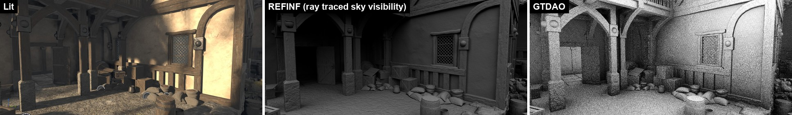
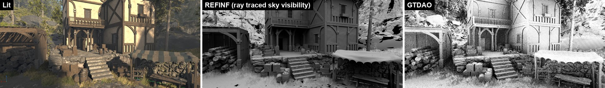

# GTDAO

A learning project: GTAO-style ambient occlusion plus a few distance field samples, in a UE5 plugin.

This is a "kind of" didactic project to explore the customization possibilities of UE5. I used the hook
that UE exposes to plug in a custom GI to add a custom Ambient Occlusion instead. It mostly follows the
GTAO approach, a pure screen-space technique, and integrates it with some samples from the distance field.
I have to say, the customization possibilities and the access to engine features, like sampling the
distance field from a shader, are pretty powerful.

Nothing here is a new technique: GTDAO combines a GTAO-style screen-space horizon march with a few samples
from the Global Signed Distance Field, both well known (see [Prior work](#prior-work)), and it is an
exercise to learn how they work and how far UE5 lets you go from a plugin.
It runs on Unreal Engine 5.8 (and only there, see [below](#why-only-ue-58)), as a plugin that plugs into the Dynamic GI "Plugin" hook
(`r.DynamicGlobalIlluminationMethod 3`) and writes UE's AO texture, in place of UE's SSAO or GTAO.
For now the result is quite noisy and would need a spatial and temporal denoiser. The distance field
samples add the occlusion of what the screen cannot see, like large or off-screen occluders.




## What the AO buffer is

The ambient occlusion buffer is the fraction of the indirect light that is not occluded: it is brighter
(higher values) where unoccluded and darker where occluded. Direct lighting is not considered, its
occlusions are the shadows. Once upon a time, in Crysis for instance, ambient occlusion was used also to
occlude the direct lighting, as a sort of replacement of near shadows, but that generates artifacts.

In UE the AO texture is applied only to the movable Sky Light diffuse, to reflections and to baked lighting.
Without a Sky Light it has no visible effect in the lit image.

## The algorithm

### Screen space: the horizon march (`GTDAOCS`)

For each pixel the algorithm marches the z-buffer in some random directions (slices) to find the horizons,
and uses the UE HZB to accelerate the search. Once the horizons are found, the unoccluded contribution is
computed analytically. Per pixel:

- The search radius is given in world units (the Post Process Volume AO Radius, or `r.GTDAO.Radius`) and
  converted to pixels, clamped to 256 px.
- Each slice gets a local reference system around the point P: the slice direction, V (from P toward the
  camera) and the axis perpendicular to both. The normal is projected onto the slice plane; the length of
  the projected normal is the slice weight, its signed angle from V is Gamma.
- The slice is marched on both sides. The samples follow a quadratic distribution, so they are denser close
  to the pixel (contacts, creases) and sparse far away, and a per pixel offset shifts them so neighbours
  sample different distances. Samples farther than 4 px read the HZB (furthest depth of each texel) instead
  of the full resolution depth.
- Each sample keeps the highest one seen so far (the horizon). Farther samples get less weight (distance
  falloff), and a lower sample pulls the horizon down a little: this is the GTAO thickness heuristic, to
  mitigate thin occluders detached from the background acting as if they had infinite thickness.
- The two horizons are clamped to the hemisphere of the normal, and the visible arc between them is
  integrated in closed form (cosine-weighted), weighted by the slice weight.
- The average over the slices is the screen-space AO, then the Post Process Volume Intensity scales the
  occlusion.

Two random generators decorrelate the slice angle (R2 sequence) and the step offset (interleaved gradient
noise). The output is raw, full resolution, one channel.

### Integrating screen space AO with the global distance field sampling (`SampleDistanceFieldCS`)

The screen-space march only sees what is on screen and within the radius. A separate pass, optionally at
lower resolution, samples the Global Distance Field with cosine-weighted rays over the whole hemisphere of
the normal, to find occlusions that are not visible in screen space. Their average visibility is the AO of
the distance field; `GTDAOCS` upsamples it (bilinear) and multiplies it into the AO.

- The directions are cosine-weighted (to account for the Lambertian term), so the result is a plain
  average of the ray visibilities. The 2D point of each ray is the texel noise moved along the R2 sequence.
- The distance field is made of several clipmaps, with a resolution that gets lower far from the camera.
  The ray start is moved along the normal by the voxel size, to avoid sampling inside our own surface.
- Instead of tracing the ray, the distance field is sampled at a few fixed points along it (4), in a
  geometric progression from `r.GTDAO.DF.MinDistance` to `r.GTDAO.DF.MaxDistance`. Around the ray we imagine
  a cone with radius t * 0.5 at distance t: the distance d to the nearest surface at the sample tells how
  much of the cone section is free, saturate(d / radius). The visibility of the ray is the smallest of them,
  like UE's DFAO and soft shadows. Fixed cost and no divergence (sphere tracing has a scene-dependent number
  of steps, and a warp waits for its slowest pixel); the result is a soft, approximate occlusion.
- The Global SDF stores distances only in a narrow band around the surfaces to save space, farther away it
  returns the band size. A cone radius larger than the band would read "occluded" in empty space, so the
  cone radius is capped to the band.
- The rays also see occluders the march already found. `MinDistance` keeps most of that overlap out.

### Passes

1. `SampleDistanceFieldCS` (only with `r.GTDAO.DF 1`): DF visibility, full resolution or one ray per NxN pixels.
2. `GTDAOCS`: the horizon march, times the upsampled DF visibility.
3. `GTDAOCompositePS`: copies the AO into UE's AO texture.

## Installation

There are no prebuilt binaries: you compile the plugin yourself. You don't need the engine source,
the Epic Games Launcher version of UE 5.8 is enough, because it also installs the Renderer headers
the plugin uses (I only built it against a source build of 5.8, so tell me if the launcher one has problems).

1. You need a C++ project (a Blueprint-only project can't compile plugins: add any C++ class with
   Tools > New C++ Class to convert it) and Visual Studio with the UE 5.8 toolchain.
2. Clone this repository into `<YourProject>/Plugins/GTDAO`:

   ```
   git clone https://github.com/salvatorespoto/GTDAO.git <YourProject>/Plugins/GTDAO
   ```
3. Open the project: the editor asks to build the missing GTDAO module, say yes (or build the project from
   Visual Studio).

The module loads at `PostConfigInit`, because the shaders must be registered before the engine compiles
them: after changing C++ code, shader parameters or cvars you have to restart the editor, Live Coding is
not enough.

### Why only UE 5.8

The plugin doesn't use only the public engine API. To get the scene textures, the view, the HZB and the
GI plugin delegates it includes private headers of the Renderer module (`Renderer/Private` and
`Renderer/Internal`, see `GTDAO.Build.cs`), and some engine internals it relies on (like where the AO
texture is written and read in the frame) were checked in the 5.8 source. Epic doesn't keep these stable
between versions, so on 5.7 or 5.9 the code may not compile, or compile and behave differently. Also the
compiled binaries load only in the engine build they were compiled with, which is why there is no release zip.

## Usage

Project settings: Dynamic Global Illumination Method = Plugin. Then, to disable all the other ambient
occlusion methods and see this one in the Ambient Occlusion buffer (Buffer Visualization > Ambient
Occlusion shows UE's AO texture, which GTDAO overwrites):

- `r.DynamicGlobalIlluminationMethod 3`: GI = Plugin, so Lumen GI (and its short-range AO) is off and our hook runs
- `r.AmbientOcclusion.Method 0`: SSAO path (1 = GTAO, which writes the AO texture on its own)
- `r.AmbientOcclusionLevels 0`: UE's SSAO does not run (it would be overwritten anyway, but it costs ~0.14 ms)
- `r.GTDAO.AO 1`

For the distance field rays, be sure that the distance fields are built:

- `r.GenerateMeshDistanceFields 1` (restart the editor)
- `r.DistanceFieldAO 1`, and `ShowFlag.DistanceFieldAO 0` to hide DFAO
- `r.AOGlobalDistanceField.DetailedNecessityCheck 0`: with GI method 3 and no DFAO user in the scene UE would skip the Global SDF
- `r.GTDAO.DF 1`

To also see it in the lit image, UE applies the AO only to the movable Sky Light diffuse:

- a movable Sky Light in the level, with Cast Ray Traced Shadow disabled: otherwise the sky diffuse goes
  through RayTracingSkyLight and the AO texture is ignored
- `ShowFlag.DistanceFieldAO 0`: DFAO is combined with min(), it usually wins and hides ours. Do not use
  `r.DistanceFieldAO 0`: it removes the Global SDF too, and `r.GTDAO.DF` would do nothing
- `ShowFlag.AmbientOcclusion 0` is not a clean switch: it also disables DFAO

| CVar | Default | |
|---|---|---|
| `r.GTDAO.Enable` | 1 | plugin on/off |
| `r.GTDAO.AO` | 0 | 1 = write UE's AO texture |
| `r.GTDAO.Radius` | 0 | world-space radius in cm, 0 = Post Process Volume AO Radius |
| `r.GTDAO.Slices` | 2 | slices per pixel |
| `r.GTDAO.Steps` | 8 | steps per side of each slice |
| `r.GTDAO.DF` | 0 | add the distance field rays |
| `r.GTDAO.DF.Rays` | 1 | >= 1: rays per pixel; 0..1: one ray per NxN pixels, N = round(1/sqrt(value)), e.g. 0.25 = 2x2 |
| `r.GTDAO.DF.MinDistance` | 50 | where the DF rays start, cm |
| `r.GTDAO.DF.MaxDistance` | 300 | where the DF rays end, cm |

Compile-time settings (`GTDAO` namespace at the top of `GTDAORenderer.cpp`): max radius in pixels (256),
thickness (0.5), HZB (on), DF cone width (0.5).

## Results

Benchmark 2026-11-11 on `PL_Medieval_Docks`, 4 views, 1395x619, RTX 2070 laptop, radius 141 cm,
2 slices x 8 steps, DF 0.5-3 m. Error against a ray traced sky visibility (REFINF), mean over the 4 views:

| | MAE vs REFINF | GPU ms |
|---|---|---|
| UE GTAO, full resolution | 0.551 | 0.121 |
| GTDAO, DF at full resolution | 0.347 | 0.224 |
| GTDAO, DF at 1/2 resolution | 0.317 | 0.193 |
| GTDAO, DF at 1/3 resolution | 0.312 | 0.183 |

Read these numbers with care. The comparison is against the sky visibility (rays up to 1 km), which GTAO
with a 141 cm radius does not try to estimate: most of its error comes from the radius, by definition.
The table shows what the distance field samples add, not that GTDAO is better than GTAO. It is also one
scene on one PC. On cost GTAO is clearly better: the GTDAO march alone takes ~0.16 ms, against
0.08-0.14 ms for the whole UE GTAO.

### And what about DFAO?

In UE the usual way to get also the big and off-screen occlusion is to keep the screen space AO and turn on
DFAO, so I measured that too, same scene and same views (GPU ms, mean of the 4 views):

| | GPU ms |
|---|---|
| UE GTAO alone | 0.121 |
| UE GTAO + DFAO | 0.486 |
| UE SSAO + DFAO | ~0.54 (one view is weird, see the benchmark) |
| GTDAO, DF at full resolution | 0.225 |
| GTDAO, DF at 1/3 resolution | 0.184 |

So what I can say is just this: on this scene GTDAO, without any denoiser, costs less than half of
GTAO + DFAO, so there is room (~0.26-0.30 ms) to add a cheap denoiser and still pay less.
What I can't say yet is that the result is "almost the same": DFAO goes up to 10 m, uses the mesh
distance fields (more detailed than the global one) and has its own filters, while GTDAO stops at 3 m on the
Global SDF. And DFAO does not end up in the AO buffer I capture, so I didn't measure its error yet.
Also, the Global SDF update cost here is ~0, because the scene is static and the Global SDF is built anyway.

Full report, with every view and error map: [Docs/Benchmarks/2026-11-11_PL_Medieval_Docks](Docs/Benchmarks/2026-11-11_PL_Medieval_Docks/README.md).

## Limitations and next steps

The output is noisy: there is no denoiser at all, every pixel uses its own few slices and its own DF ray,
and the noise changes every frame. Several improvements can be done, first of all the denoiser:

- **Denoiser**: spatial (edge-aware, depth + normal weights, e.g. an à-trous filter) and temporal accumulation
  with reprojection; UE's `ScreenSpaceDenoise` is also an option to evaluate.
- **Cost of the march**: still about twice UE's GTAO march at the same resolution.
- **Lower resolution** for the march, with a depth-aware upsample.
- **Edges of the low resolution DF**: the bilinear upsample bleeds across depth edges for about one block.
- **Thickness**: occluders are still mostly treated as infinitely thick; a visibility bitmask would fix it.
- Every method is still brighter than the sky visibility, near walls and big occluders.

## Prior work

Everything used here comes from existing work:

- GTAO: Jimenez, Wu, Pesce, Jarabo, "Practical Real-Time Strategies for Accurate Indirect Occlusion"
  (SIGGRAPH 2016 course), and UE's own GTAO implementation (`PostProcessAmbientOcclusion.usf`).
- UE's Distance Field Ambient Occlusion, which already combines with the screen-space AO
  (`min(DFAO, SSAO)`), and its cone samples against the distance field, like the soft shadows.
- Lumen, which combines screen-space tracing with distance field tracing, and its short-range AO with a
  horizon search and a visibility bitmask.
- "Global Illumination for Poor People" (TurboGI devlog), the starting point of this project.

About the GI plugin hook itself, I learned it was there (and usable) from two people who tried it first:

- Tatsuhiro Tanaka, ["UE5のGIプラグインを調べてみた、ニセGIも作ってみた。"](https://qiita.com/dgtanaka/items/85bdf4e1e84428d722a3)
  (Qiita, December 2024): what the hook gives you, and a fake GI made with it.
- Dmitry Karpukhin ([@skx_doom](https://x.com/skx_doom)), a custom GI prototype on the same hook, presented by
  80 Level: ["Custom Global Illumination Plug-In for Unreal Engine 5"](https://80.lv/articles/custom-global-illumination-plug-in-for-unreal-engine-5)
  (June 2025), which also points to Tanaka's article.

As far as I found, the official documentation says very little about it: the "Plugin" value of
[`EDynamicGlobalIlluminationMethod`](https://dev.epicgames.com/documentation/unreal-engine/API/Runtime/Engine/EDynamicGlobalIlluminationMethod-)
("Use a plugin for Global Illumination") and the delegates in `FGlobalIlluminationPluginDelegates`
(Renderer module). The rest I got by reading the engine source.

## Building

To check that the plugin compiles for the editor and for the game targets (Development and Shipping; a
Shipping error shows up only here, not in the editor build), package it with `BuildPlugin`:

```powershell
& "<UE 5.8>\Engine\Build\BatchFiles\RunUAT.bat" BuildPlugin `
    -Plugin="<path>\GTDAO\GTDAO.uplugin" -Package="<temp folder>\GTDAO_pkg" -TargetPlatforms=Win64 -Rocket
```

The package folder is only a check, delete it afterwards: no binaries are released (see [Why only UE 5.8](#why-only-ue-58)).

## What is in this repository

- `GTDAO.uplugin`, `Source/GTDAO`: the C++ module (cvars, shader classes, passes, the GI plugin delegate),
  most of it in `Source/GTDAO/Private/GTDAORenderer.cpp`.
- `Shaders/Private/GTDAO.usf`: all the shaders, with a lot of comments (I wrote them to understand every line).
- `Docs/`: the images of this page and the benchmark.

The test levels come from Fab and are not in the repository.

## License

MIT, see [LICENSE](LICENSE).
